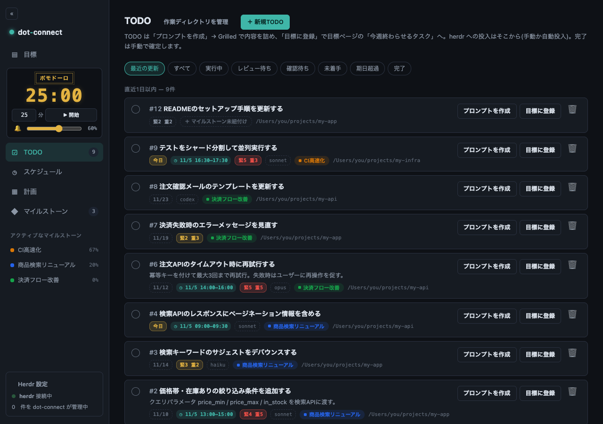
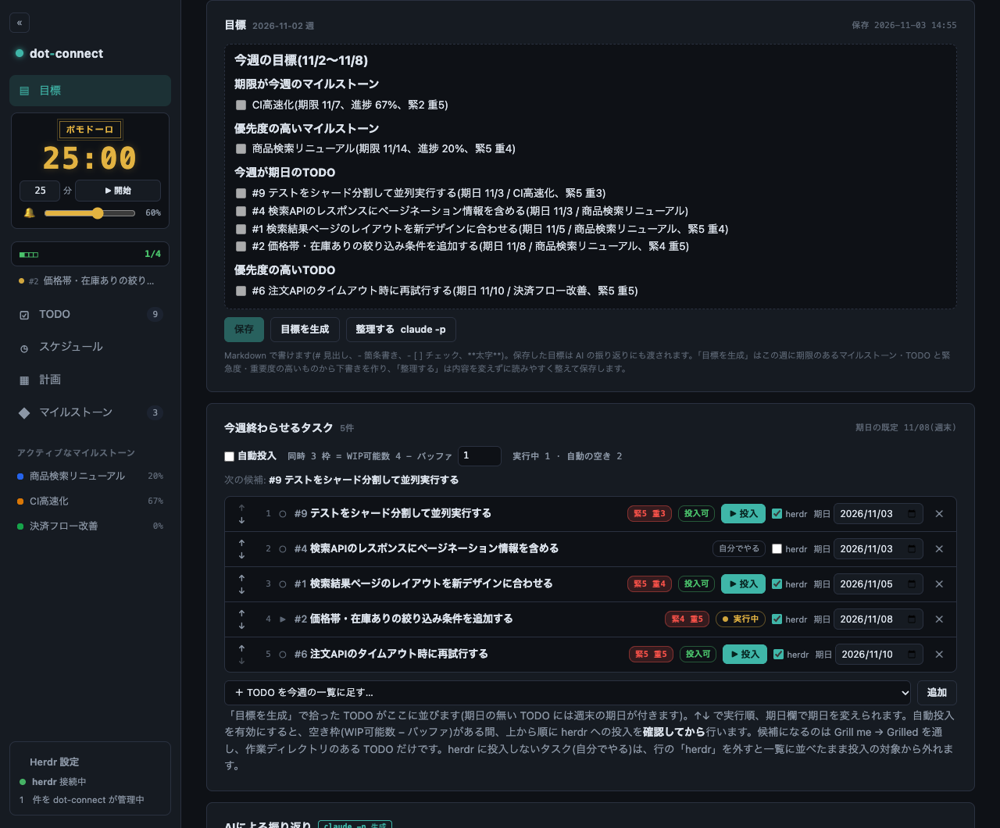
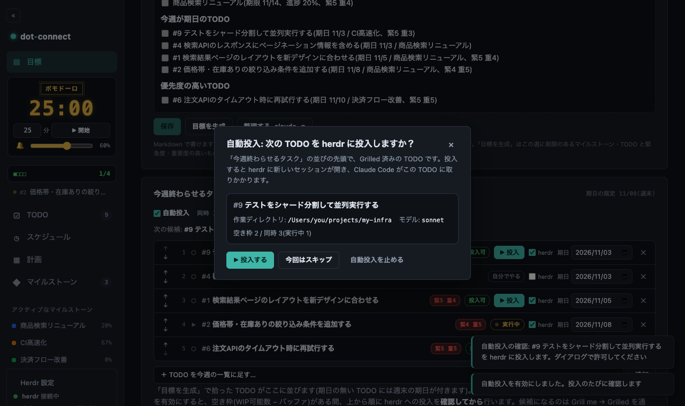
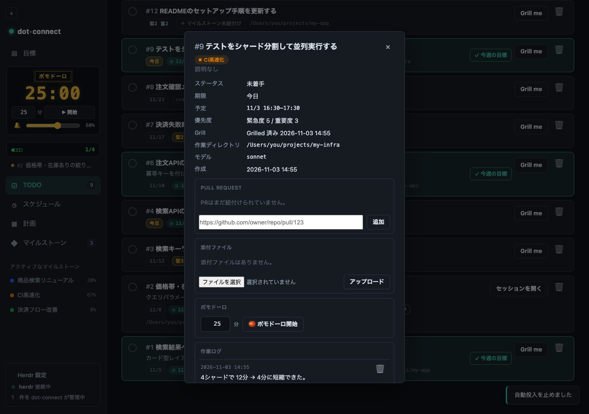
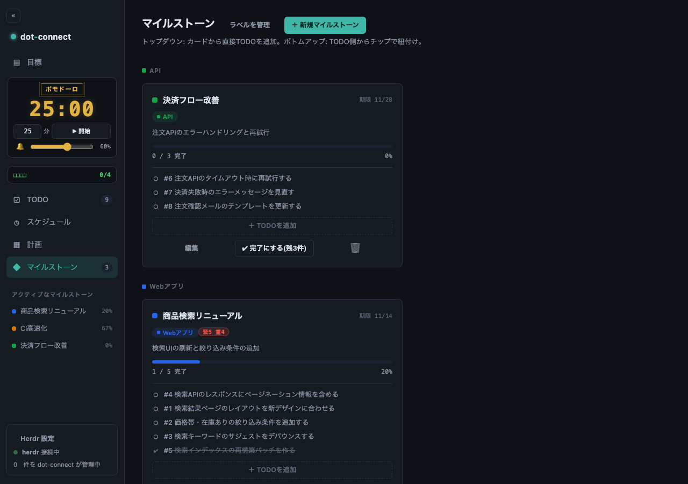
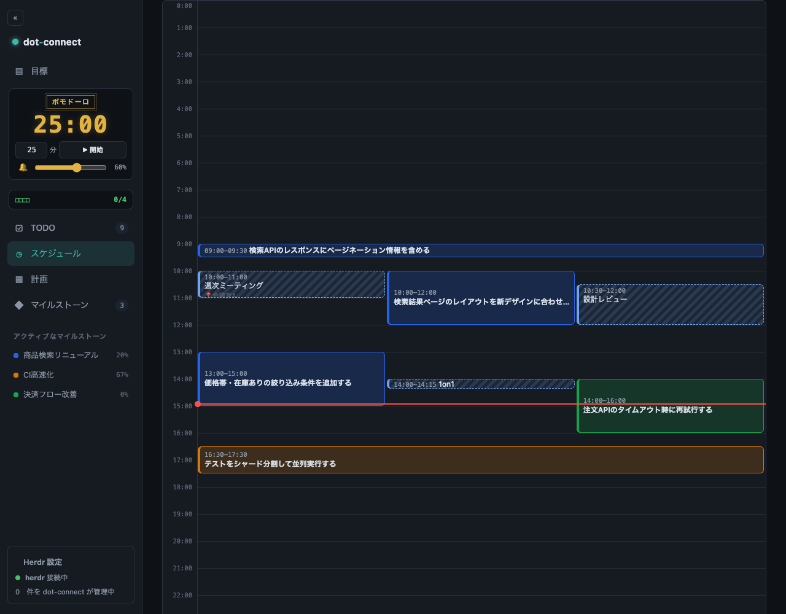
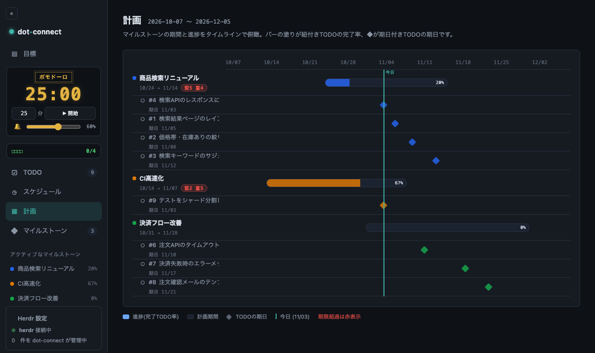
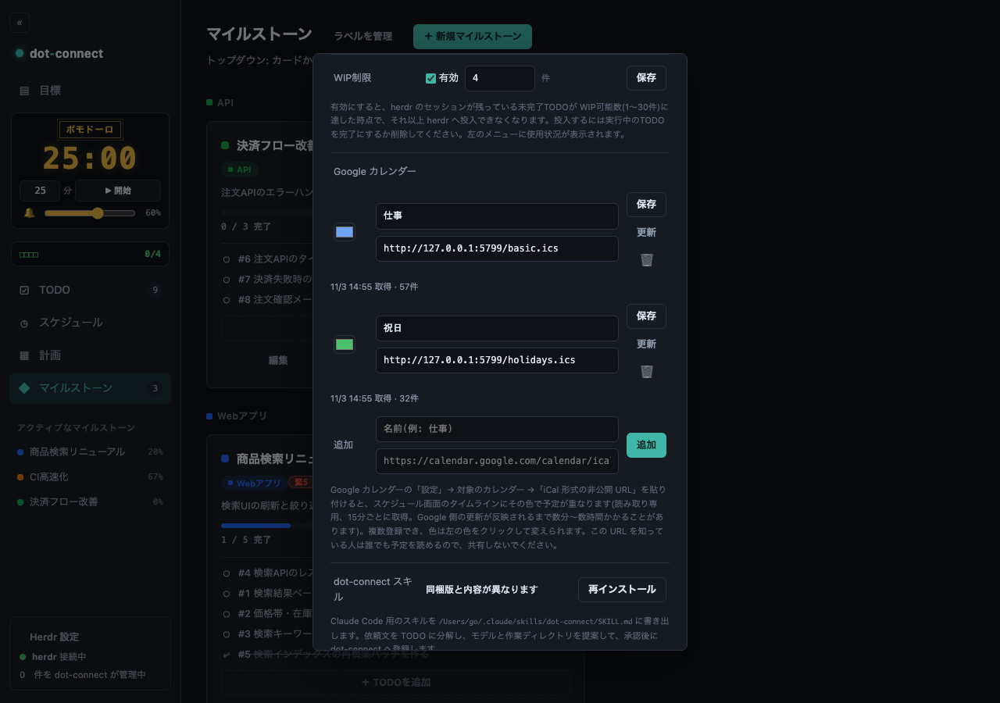

# dot-connect

TODO管理 + マイルストーン管理 + herdr連携のローカルWebアプリ。TODOをそのまま
herdr上のClaude Code / Codex CLIセッションとして投入(dispatch)し、進捗を
同じ画面で追える。ブラウザ版と、同じUIを同梱したデスクトップアプリ(Tauri)
の2形態で動く。



## スクリーンショット

| 目標(起動時に開く。週の目標、今週終わらせるタスク、毎日更新される統計、AI の振り返り) |
| --- |
|  |

| 自動投入の確認(herdr へ投入する前に必ず許可を取る) | TODO一覧(Grilled 済みは枠と背景が変わり「目標に登録」が出る) |
| --- | --- |
|  |  |

| TODO詳細(緊急度/重要度・Grill・PR紐付け・添付・ポモドーロ・作業ログ) | マイルストーン(緊急度/重要度付き) |
| --- | --- |
|  |  |

| スケジュール(1日の予定。Google カレンダーの予定を色分けで重ねる) | 計画(マイルストーンのタイムライン、優先順位順) |
| --- | --- |
|  |  |

| 設定: Google カレンダー(複数登録、カレンダーごとの色) |
| --- |
|  |

スクリーンショットのデータは `scripts/seed-demo.ts` で再現できる(手順は
[デモデータ](#デモデータ)を参照)。

## 使い方(1週間の流れ)

「やることを集めて、詰めて、今週分を並べ、herdr に流す」が基本の流れ。

1. **`/dot-connect` でやることをざっくりまとめる** — Claude Code で `/dot-connect`
   スキルを呼び、依頼文やメモを貼る。スキルが TODO とマイルストーンに分解して
   提案する([Claude Code スキル](#claude-code-スキルdot-connect))。
2. **整理してもらって TODO として登録する** — 提案を直して承認すると、
   dot-connect に TODO(タイトル・詳細・モデル・作業ディレクトリ)が入る。
   GitHub Issue からの取り込みや、TODO 画面の「＋ 新規TODO」でも作れる。
3. **TODO に緊急度／重要度をつける** — TODO の詳細ダイアログ(タイトルを
   クリック)か新規フォームで、緊急度と重要度を 1〜5 で付ける。一覧・計画・
   スケジュールの並びに効き、「緊5 重3」のバッジで見える。マイルストーンにも
   同じ 2 軸がある。
4. **プロンプトを作成 で詳細を詰める** — TODO 行の「プロンプトを作成」で herdr のセッションが
   開き、Claude Code が質問しながら内容を固める。固まったら「Grilled」を押すと
   TODO のタイトルと説明が整理した内容に置き換わり、行の枠と背景がアクセント色に
   なる(Grilled 済み)。
5. **今週終わらせるタスクに追加** — Grilled 済みの行に出る「目標に登録」を押すと、
   目標ページの「今週終わらせるタスク」に並ぶ。期日が無ければその週の日曜が
   付く。目標ページの「目標を生成」でも、今週が期日・期限超過・緊急度か重要度が
   高い TODO をまとめて拾える。herdr に流さず自分でやるタスクは Grill を通さず
   「目標に登録」すればよい(Grill 前の行にも控えめな「目標に登録」があり、
   「自分でやる」として入る)。herdr でやるか自分でやるかは TODO 側で決まり、
   目標ページの行には「herdr」「自分」の印が付くだけで切り替えはしない。
   「自分でやる」で入れた TODO をあとから「プロンプトを作成」→ Grilled にすると、
   その行は登録し直さなくても「herdr」に切り替わる。
6. **目標を整理して期日を設定** — 目標ページで Markdown の目標を書く(「整理する」
   で `claude -p` が読みやすく整える)。「今週終わらせるタスク」は ↑↓ で実行順を
   決め、各行の期日欄で期日を直す。
7. **自動投入で順次 herdr に流す** — 一覧の「自動投入」を有効にすると、
   空き枠(WIP可能数 − バッファ)がある間、上から順に投入を提案する。確認
   ダイアログで「▶ 投入する」を押したものだけが herdr で動く(勝手には
   始めない)。急ぐものは各行の「▶ 投入」で手動でも投入できる(バッファぶんの
   枠まで)。動いているセッションはサイドバーの WIP メーターの下に並び、
   完了は TODO の「完了にする」で確定する。

Google カレンダーの予定をスケジュール画面に重ねるには、設定(⌘,)の「Google
カレンダー」に iCal 形式の非公開 URL を登録する([Google カレンダーの予定を
重ねる](#google-カレンダーの予定を重ねる))。

## 主な機能

- **TODO**: 説明・緊急度/重要度・期日・予定(開始/終了時刻)・作業ディレクトリ・
  モデルを持つTODOの管理。期限切れ/最近の更新での絞り込みと並び替え、詳細
  ダイアログ(タイトルをクリック。期日は「編集」を開かなくても詳細の期限欄で
  選ぶとすぐ保存される。今週の一覧にある TODO の期日は空にできない)
- **優先順位(緊急度・重要度)**: TODO とマイルストーンの両方に、緊急度と
  重要度をそれぞれ 1〜5 で持つ(1 が最低/未設定、5 が最高)。並び順は
  「合計点が高い順、同点なら緊急度が高い順」で、TODO 一覧・スケジュールの
  期日欄・計画ページのマイルストーン・サイドバーのアクティブなマイルストーンに
  効く。行やカードには「緊5 重3」のバッジが出る(両方 1 なら出ない)。
  以前の 3 段階の優先度(なし/低/高)は初回起動時に緊急度 1/3/5 へ移行する
  (`priority` 列は残るが読まれない)
- **スケジュール**: Google カレンダーの日表示のように1日分だけを描く画面。
  上段にその日が期日のTODOの一覧、下段に開始・終了時刻を設定したTODOを置く
  0〜24時のタイムライン(下記)
- **マイルストーン / ラベル**: マイルストーンごとの進捗表示、ラベルでの
  グルーピング
- **herdrへの投入**: TODO 一覧からは投入しない。「プロンプトを作成」→ Grilled で内容を
  詰めた TODO(行の枠と背景がアクセント色になる)を「目標に登録」で目標ページの
  「今週終わらせるタスク」に入れ、そこから投入する(Grill を通していない TODO も
  「目標に登録」できるが、その場合は herdr に流さない「自分でやる」タスクになる。
  あとから Grilled にすれば「herdr」に切り替わる) —— 各行の「▶ 投入」
  (プロンプト・作業ディレクトリ・モデルを確認するダイアログ。自動投入が空けて
  おくバッファぶんも使える)か、自動投入(下記)。投入は既存どおり herdr 上の
  Claude Code / Codex CLI セッションとして動き、進捗を同期する
- **Grill**: TODOの内容をherdr上のClaude Codeとの対話で詰め、結果でタイトル・
  説明を書き換える(下記)
- **プロンプトから複数登録**: 「新規TODO」から、dot-connect スキル
  (`/dot-connect`)を打ち込んだ Claude Code セッションを herdr に開き、依頼文を
  複数のTODOに分解して登録する(下記)
- **GitHub Issue の取り込み**: 「新規TODO」から、リポジトリ(`owner/repo` か
  GitHub の URL)を指定して Issue 一覧を `gh` で取得し、選んだ Issue を TODO
  として登録する(下記)
- **herdr セッションからの紐づけ**: herdr 上で動いている Claude Code から
  `/dot-connect` スキル(MCP `link_todo_session` / `POST /api/todos/:id/session`)で、
  そのセッションを TODO の herdr セッションとして紐づける。以後は投入した
  セッションと同じ扱い(「セッションを開く」・状態同期・WIP・完了時のclose)
- **添付ファイル**: TODOへのファイル添付と、投入時に含める添付の選択
- **作業ログ**: TODOごとのコメント(作業ログ)
- **PullRequest紐付け**: GitHub PRのURLをTODOに紐付け、`gh` でタイトル・状態を
  取得。openなPRを持つTODOは「レビュー待ち」として表示
- **目標(週次レポート)**: 起動時に開くダッシュボード。完了数・登録数・投入回数・
  期日内完了率・リードタイム・日別の登録/完了・登録から完了が速かった TODO
  ベスト5・緊急度別/重要度別/マイルストーン別・未完了の状況を開くたびに DB から集計し、
  `claude -p` による振り返りを1日1回自動で生成する(下記)
- **ポモドーロタイマー**: TODOに紐付けた集中タイマー(終了時チャイム、音量調整)
- **外部連携**: 許可リスト方式のAPIトークン認証、stdio MCPサーバー

### 新規TODOの3つの作り方

「＋ 新規TODO」を押すとメニューが開き、いずれかを選ぶ。

- **1件を入力して登録**: 従来のフォーム。タイトル・説明・マイルストーン・
  緊急度・重要度・期日・作業ディレクトリ・モデルを入力して1件作る。
- **GitHub Issue から取り込み**: リポジトリを `owner/repo` か GitHub の URL
  (リポジトリ・Issue・ファイルのどれでもよい)で指定し、「一覧を取得」で
  `gh issue list` の結果(状態 Open/Closed/すべて、`gh` の検索構文で絞り込み可、
  最大200件)を一覧する。チェックした Issue が「取り込む」で1件ずつ TODO になる
  (`gh issue view` で取り込み時点の内容を読む)。タイトルは Issue のタイトル、
  説明は1行目が Issue の URL、空行を挟んで Issue 本文(TODO の上限 200/4000
  文字に収まるよう末尾を切る)。ダイアログ下部で選んだマイルストーン・緊急度・重要度・
  作業ディレクトリ・モデルは取り込む全件に付く。説明に同じ Issue の URL を
  持つ未完了 TODO があるものは「取り込み済み」としてチェックできない(その
  TODO が完了済みなら再取り込みできる)。一部の Issue だけ失敗したときは
  取り込めた分は登録し、失敗した番号と `gh` の理由をトーストで出して、失敗分を
  チェックしたままダイアログを残す。`gh` が未インストール/未認証なら一覧の
  取得時にその理由が表示される。一度一覧したリポジトリはブラウザに記憶し
  (最大8件)、次回の入力候補になる。
- **プロンプトから複数登録**: dot-connect が herdr にワークスペースを作り、
  スキルの記録ファイル置き場(`~/.local/dot-connect/notes`、
  `DOT_CONNECT_NOTES_DIR`)を作業ディレクトリにして Claude Code を起動し、入力欄に
  `/dot-connect ` とだけ打ち込んで止める。タブとターミナルを前に出すので、
  続けて依頼文を入力して送信すると、スキルが TODO への分解・マイルストーンの
  提案・登録まで進める。初回だけ出る Claude Code のフォルダ信頼確認は
  dot-connect 自身のディレクトリなので自動で承認する。このセッションは TODO に
  属さないため DB には記録せず、WIP にも数えない。終わったらユーザーが閉じる。
  スキルが未インストール(設定の「スキルをインストール」)のときは選べない。

### スケジュール(1日の予定)

サイドバーの「スケジュール」は、Google カレンダーの日表示のように**1日分だけ**を
表示する。← → と日付入力で日を移動し、「今日」で戻る。

- **期日(上段)**: その日が期日のTODOの一覧。カレンダーの「終日」欄に相当し、
  タイムラインとは別に並べる(未完了→優先順位→ID順)。クリックで詳細ダイアログ。
- **タイムライン(下段)**: 0〜24時のグリッド。TODOの**予定**(開始時刻・終了
  時刻、`scheduledStart` / `scheduledEnd`)をブロックとして置く。重なる予定は横に
  並べ、今日を表示しているときは現在時刻の線を引く。ブロックのクリックで詳細
  ダイアログ。
- **予定を入れる**: 時間帯をクリックすると、その時刻から1時間の予定を入れる
  フォームが開く。既存の未完了TODOを選ぶか、タイトルを入力して新しいTODOを作る。
  TODOの新規フォーム・詳細ダイアログの編集でも「予定」(日付・開始・終了)を
  設定でき、終了を空にすると開始の1時間後になる。

予定は期日とは独立した値で、期日は締切、予定は「いつ取り組むか」。値は
`YYYY-MM-DDTHH:MM` のローカル時刻(タイムゾーン無し)で、開始と終了は必ず
ペアで指定し、同じ日・開始<終了でなければ 400 になる。両方 `null` で予定を外す。

#### Google カレンダーの予定を重ねる

設定(⌘,)の「Google カレンダー」に、名前と、Google カレンダー側の「設定」→
対象のカレンダー →「iCal 形式の非公開 URL」を入れて追加すると、その
カレンダーの予定がスケジュール画面に重なる。複数登録でき、カレンダーごとに
色を持つ(追加順にパレットから割り当て、色をクリックして変えられる)。
OAuth や Google Cloud の設定は要らない。

- 時刻のある予定はタイムラインにそのカレンダーの色の斜線ブロックとして並ぶ
  (TODO の予定と重なれば横に並ぶ)。終日の予定は上段の「期日」欄にカレンダー
  名のタグ付きで出る。どちらも読み取り専用で、クリックしても何も起きない。
  タイムラインの上にはカレンダーごとのタグ(その日の件数、失敗していれば
  その理由)と「更新」が並ぶ。
- サーバーが起動時と 15 分ごとに取り直す(`POST /api/calendar/refresh` /
  タイムライン上の「更新」で即時)。取れた ICS は DB に残すので、再起動直後や
  オフラインでも前回の予定が出る。Google 側のフィード更新には数分〜数時間の
  遅れがあり、「いま入れた予定がすぐ出る」とは限らない。
- 繰り返し予定(RRULE、移動・削除した回を含む)は ical.js で展開する。展開は
  今日の 90 日前〜365 日後の窓で行い、窓の外の日は「同期の範囲外」と出る。
  時刻は TZID / UTC / VTIMEZONE を解決してローカル壁時計に直す。日をまたぐ
  予定はその日の分だけに切る(`00:00` / `24:00`)。
- 非公開 URL は実質的な認証情報(URL を知っていれば誰でも予定を読める)。
  `calendars` テーブルに保存し、ログにもエラーメッセージにも出さない。
  `GET /api/calendar/events?date=YYYY-MM-DD`(`{ status, events }`、各予定に
  `calendarId` / `calendarName` / `color`)、`POST /api/calendar/refresh`、
  一覧の管理 `GET/POST /api/calendar/sources`・`PATCH/DELETE /api/calendar/sources/:id`・
  `POST /api/calendar/sources/:id/refresh` はブラウザ UI 専用で、API トークン
  では届かない。カレンダーを外すとキャッシュも消える。最初の版の URL 1 本の
  設定は、起動時に 1 件目のカレンダーとして自動で移される。

### 目標ページ(週次レポート、毎日更新)

サイドバーの一番上(ラベルは「目標」)にあり、アプリを開くとまずこの画面が出る。月曜始まりの
1週間が単位で、← → と「今週」で週を移動できる(→ は今週まで)。

- **統計**(`GET /api/reports/weekly/stats`): 保存せず、開くたび・TODO が
  動くたびに DB から集計し直すので常に最新。完了と登録のバランス(ドーナツ)、
  完了数・登録数・herdr 投入回数(それぞれ前週比)、期日内に完了した割合、
  マイルストーン関連率、登録→完了のリードタイム(中央値・平均)、日別の登録/
  完了の棒グラフ、登録から完了が速かった TODO ベスト5(クリックで詳細)、
  完了の緊急度別・重要度別・マイルストーン別の内訳、未完了の状況(残り・期限切れ・
  この週が期日)。日付の境界はローカル暦。
- **目標**(`GET/POST /api/reports/weekly/goal`): 週ごとの自由入力(Markdown)。
  フォーカスするまでは Markdown を描画した表示(見出し・箇条書き・`- [ ]` の
  チェックリスト・太字・リンクなど)で、クリックすると入力欄に切り替わる。保存
  ボタンか Cmd/Ctrl+Enter、または欄を離れたときに保存される(4000文字まで)。
  「目標を生成」(`POST /api/reports/weekly/goal/generate`)は、その週に期限の
  あるマイルストーン・TODO、期限超過のもの、緊急度か重要度が 4 以上のものを
  DB から拾って Markdown のチェックリストの下書きを作り、保存する(LLM は
  使わない。既に書いてあれば、もう一度押したときだけ置き換え、「元に戻す」で
  戻せる)。
  生成で拾った TODO は、目標の下の**今週終わらせるタスク**にも実行順で入る。
- **今週終わらせるタスク**(`GET/POST /api/reports/weekly/queue`、
  `PUT …/queue/order`、`DELETE …/queue/:id`): その週に片付ける TODO の実行順。
  手でも足す・外す(TODO 自体は消えない)・↑↓で並べ替えられる。週に入れた
  TODO には必ず期日が付く(無ければその週の日曜)。各行の期日欄で変えられる。
  各行には「herdr」か「自分」の印が付く(`dispatch`。Grilled 済みを登録すると
  herdr、Grill を通さず登録すると自分)。「自分」の行は一覧には並ぶが自動投入・
  手動の「投入」の対象から外れる。herdr か自分かは TODO 側で決まるもので、
  目標ページでは表示するだけ(API の `PATCH …/queue/:id` の `dispatch` は残る)。
- **自動投入(auto mode)**: 一覧の「自動投入」を有効にすると、空き枠
  (WIP可能数 − バッファ。バッファは既定 1 で同じ行から変えられる)がある間、
  並びの上から順に herdr への投入を提案する(バッファぶんの枠は手動の「▶ 投入」
  のために残す)。候補になるのは未完了・セッション
  無し・**Grilled 済み**(「プロンプトを作成」→ Grilled を通した、`grilledAt` が入っている)・
  作業ディレクトリありの TODO だけ。投入は**必ず確認ダイアログで許可を
  もらってから**行う(勝手に始めると herdr 側で権限の確認に引っかかることが
  あるため)。「今回はスキップ」はその起動中だけ飛ばし、「自動投入を止める」で
  無効になる。どのページを見ていても提案は出る(30 秒おきに今週の並びを
  読み直す)。設定は `autoRunEnabled` / `autoRunBuffer`(`GET/PATCH /api/settings`)。
  「整理する」(`POST /api/reports/weekly/goal/tidy`)は `claude -p` で内容・
  意図を変えずに読みやすく整え(重複をまとめ、箇条書きに)、その結果を保存
  する。「整理前に戻す」で直前の本文に戻せる。保存した目標は下の AI の
  振り返りにも渡され、目標に対する進み具合が要約・提案に含まれる。
- **AI による振り返り**(`claude -p`): 上の統計と目標を材料に要約・注意点・
  提案を生成して保存する。サーバーが起動時と1時間ごとに確認し、今週分が無いか
  最後の生成が今日より前なら生成し直す(1日1回)。画面の「AI分析を(再)生成」
  やネイティブメニューの再生成はいつでも実行でき、その日の自動分も済んだ
  扱いになる。`DOT_CONNECT_REPORT_AUTO_REFRESH=0` で自動生成を止められる。

### Grill(TODOを対話で詰める)

「プロンプトを作成」ボタンを押すと、dot-connect が一時ディレクトリ
`<DBファイルのあるディレクトリ>/grill/todo-<id>` を作り、`TODO.md`(現在の
タイトルと説明)とインタビュー手順書 `GRILL.md` を置いて、そこを作業
ディレクトリにした herdr セッションで Claude Code を起動する。Claude は
`GRILL.md` に従って、TODO の前提が書かれないまま残らないところまでユーザーに
質問を重ね、合意できたら同じディレクトリに `GRILLED.md` を書く。Grill の
セッションは TODO の herdr セッションとして扱われる(「セッションを開く」・
WIP制限・削除時のガードがそのまま効く)が、投入履歴には数えない。Grill 中の
TODO は投入できない。

インタビューが終わったら「Grilled」を押す。`GRILLED.md` を読んで TODO の
タイトルと説明を置き換え、セッションを閉じて一時ディレクトリを消す。
`GRILLED.md` がまだ無ければ、セッションに今すぐ書くよう促して最大90秒待つ。
それでも無ければ 409 で、もう一度押してもらう。セッションが結果を書かずに
終わっていれば Grill を取り消す。TODO を完了・削除したときも一時ディレクトリは
消える。

`GRILLED.md` の形式(1行目が見出し、空行のあとが説明。上限は通常のTODOと同じ
タイトル200文字・説明4000文字):

```markdown
# <新しいタイトル(1文で、それだけで指示として通じるもの)>

## 背景
## やること
## 決めたこと
## 完了条件
## 注意点
```

Grill の Claude Code は `claude --permission-mode acceptEdits` で起動する
(TODO にモデルが設定されていれば `--model` も付く。`codex` の TODO でも Grill は
Claude Code の既定モデルで行う)。編集の自動承認が効くのは dot-connect が
持つこの一時ディレクトリの中だけで、`GRILLED.md` を確認なしに書かせるための
もの。

## スタック

Bun + TypeScript / Hono / zod / bun:sqlite(デスクトップ版は Tauri v2)

## セットアップ

前提: [Bun](https://bun.sh)。投入(dispatch)機能を使う場合は加えて `herdr` と
`claude`(任意で `codex`)のCLI、PR情報の取得には `gh` が必要(いずれも無くても
TODO管理自体は動く)。投入とセッションを開く操作はmacOSのみ対応。

```bash
bun install
bun run src/server.ts   # http://localhost:5757
```

## 環境変数

| 変数 | 既定値 | 説明 |
| --- | --- | --- |
| `PORT` | `5757` | HTTPサーバーのポート |
| `DB_PATH` | `<リポジトリルート>/data/dot-connect.db`(絶対パス) | SQLiteファイルパス |
| `HERDR_BIN` | `herdr` | herdr CLIのパス |
| `CLAUDE_BIN` | `claude` | claude CLIのパス |
| `CODEX_BIN` | `codex` | Codex CLIのパス(モデルに `codex` を選んだ投入で使う) |
| `GH_BIN` | `gh` | GitHub CLIのパス。TODOに紐付けたPRのタイトル・状態の取得と、GitHub Issue の一覧・取り込み(`gh issue list` / `gh issue view`)に使う(いずれも読み取り専用)。未インストール/未認証でもPR URLの登録自体は成功し、取得できなかった理由がそのPRに記録される。Issue の一覧はその理由を表示して失敗する |
| `TERMINAL_APP` | (未設定) | 設定時のみ open-session で osascript activate |
| `HOST` | `127.0.0.1` | バインドアドレス。loopback (`127.0.0.1`/`localhost`/`::1`) 以外に変更する場合は `DOT_CONNECT_API_TOKEN` の設定が必須(未設定だと起動を拒否する) |
| `DOT_CONNECT_API_TOKEN` | (未設定) | 外部からのAPIアクセス用トークン。未設定ならAPIトークン認証は無効(従来どおりブラウザの同一オリジンアクセスのみ) |
| `DOT_CONNECT_ALLOWED_MODELS` | `opus,sonnet,haiku,fable,codex` | TODOの`model`(投入時に使うClaude Codeのモデル。`codex` だけは特別で、Claude Codeの代わりにCodex CLIを起動する)に指定できる値のカンマ区切り許可リスト。ここに無い値はTODOの作成/更新/投入で400になる |
| `STATIC_DIR` | `<リポジトリルート>/public`(絶対パス) | 静的フロントエンドの配信元。相対パスはリポジトリルート基準で絶対化される |
| `DOT_CONNECT_REPORT_AUTO_REFRESH` | `1` | 週次レポートの AI 分析を1日1回(起動時と、その後1時間ごとの確認で日付が変わっていたら)自動で生成し直す。`claude -p` を呼ぶので、止めたいときは `0` |
| `DOT_CONNECT_DESKTOP` | (未設定) | デスクトップアプリのシェルがサイドカー起動時に設定する。stdinのEOFで自己終了するようになるため、通常は手で設定しない |
| `DOT_CONNECT_MCP_BIN` | (未設定) | 同梱MCPサーバーのバイナリパス。デスクトップアプリのシェルが設定し、設定ダイアログの「MCP登録コマンド」に使われる |
| `DOT_CONNECT_NOTES_DIR` | `~/.local/dot-connect/notes` | dot-connect スキルの記録ファイル(`workspaces.md` / `models.md` / `history.md`)の置き場所 |
| `CLAUDE_CONFIG_DIR` | `~/.claude` | 設定ダイアログからスキルをインストールする先(`<ここ>/skills/dot-connect/SKILL.md`) |

`DB_PATH` の既定値はカレントディレクトリに依存しない絶対パスに解決される
(`src/config.ts` 自身のファイル位置からリポジトリルートを求め、そこからの
絶対パスにする)。どのディレクトリから `bun run src/server.ts` を起動しても
常に同じDBファイルを見るため、起動場所の違いでデータが消えたように見える
事故を防いでいる。`DB_PATH` を明示的に指定する場合、絶対パスならそのまま、
相対パスならリポジトリルート基準で絶対化される(cwd基準ではない)。起動時に
実際に使用しているDBパスは stderr のログ(`Using database at ...`)で確認できる。
親ディレクトリ(既定では `data/`)が存在しない場合は起動時に自動作成される。

## ディレクトリ構成

```
src/
  config.ts, logger.ts
  db/            # bun:sqlite マイグレーション + リポジトリ (todos/milestones/labels/workspaces/reports ほか)
  herdr/         # exec (ExecFn注入) / herdrClient / statusSync
  services/      # dispatchService / sessionService / reportService / claudeRunner ほか
  api/           # zodバリデーション付きHonoルート、apiTokenAuth/csrf
  mcp/           # MCPサーバー(stdio)。HTTP API経由でtodos/milestones/labels/workspacesとPR紐付けのみ操作
  server.ts
public/          # 静的フロントエンド(ビルド不要の素のHTML + ESモジュール)
desktop/         # Tauri v2 のデスクトップアプリシェルとサイドカーのビルドスクリプト
data/            # 既定のSQLite置き場(DB本体は .gitignore 済み)
tests/           # bun:test。herdr/claude/実サーバーはすべてフェイク注入、実行しない
```

## 外部からのAPIアクセス(APIトークン)

`DOT_CONNECT_API_TOKEN` を設定すると、`Authorization: Bearer <token>` ヘッダを
持つリクエストがブラウザの同一オリジン制限(CSRF)なしにAPIへアクセスできる
ようになる。ただし**アクセスできるのは todos / milestones / labels /
workspaces の CRUDエンドポイント、TODOのPR紐付け
(`/api/todos/:id/pull-requests` 配下)、herdr セッションの紐付け/解除
(`POST`/`DELETE /api/todos/:id/session`)、`GET /api/models` のみ**(許可リスト
方式。新しいエンドポイントが増えても、このリストに明示的に追加しない限り
外部トークンからは使えない)。

**意図的に外部トークンからは使えないエンドポイント**(実行コスト・RCEリスク
があるため):
- `POST /api/todos/:id/dispatch`(任意のディレクトリで任意のプロンプトの
  Claude Codeセッションを起動する。実質的にRCE)
- `POST /api/todos/:id/open-session`(osascriptを実行する。
  なお紐付けだけを行う `POST /api/todos/:id/session` は起動を伴わないので許可している)
- `POST /api/todos/:id/grill` / `POST /api/todos/:id/grilled`(Claude Code
  セッションの起動・終了)
- `POST /api/reports/weekly/generate`(`claude -p` を実行してコストが発生する)
- `POST /api/herdr/sync`
- `GET /api/github/issues` / `POST /api/github/issues/import`(サーバー上の
  `gh` で GitHub に問い合わせる)

トークンが間違っている場合は401、許可されていないエンドポイントを叩いた
場合は403が返る。トークンが正しい場合、Originが不正でも(=ブラウザ以外の
クライアントでも)アクセスできる。

### バインドアドレスによる挙動の違い(重要)

- **`HOST=127.0.0.1`(既定、loopback)の場合**: 従来どおり、このマシン上の
  プロセスしか到達できない前提の脅威モデルのまま。トークンを送らないリクエ
  ストは(ブラウザと同じ)Origin/Sec-Fetch-Siteベースの同一オリジンチェック
  にフォールバックする。
- **`HOST` を loopback 以外(`0.0.0.0` など)に変更した場合**: **`/api/*` への
  全リクエスト(GETを含む)で有効なトークンが必須になる。** `Authorization`
  ヘッダが無ければ即401。Origin/Sec-Fetch-Siteは非loopback時には信頼しない
  ——これらはブラウザ以外のクライアントが自由に詐称できるヘッダであり、
  ネットワーク越しに到達できる相手には偽装される前提で扱う必要があるため。
  そもそも `DOT_CONNECT_API_TOKEN` が未設定だと起動そのものを拒否する(前述)。
- **ブラウザUI(`public/` の静的配信)は非loopback時には配信されない。**
  SPAはAPIトークンを安全に保持できないため、非loopbackでUIだけ配信しても
  結局どのAPIも呼べない。中途半端に見せるよりも配信自体を止める設計にして
  いる。非loopback時に `/` 等へアクセスすると404
  (`ブラウザUIは非loopbackバインドでは配信されません`)が返る。

### 設定手順

```bash
# ランダムなトークンを生成する例
export DOT_CONNECT_API_TOKEN=$(openssl rand -hex 32)
bun run src/server.ts
```

起動ログに `APIトークン認証: 有効` と出れば設定完了。以降、以下のように
アクセスできる:

```bash
curl -H "Authorization: Bearer $DOT_CONNECT_API_TOKEN" http://127.0.0.1:5757/api/todos
```

LAN上の別ホストからアクセスしたい場合は `HOST=0.0.0.0` などを設定するが、
その場合 `DOT_CONNECT_API_TOKEN` の設定が**必須**になる(未設定だと起動時に
エラーで拒否される)上、**ブラウザUIは配信されなくなり、すべてのリクエスト
にトークンが必要になる**(上記参照)。LANからはAPI/MCP経由でのみ利用する
運用を前提とすること。

### API変更の画面への反映

ローカルのブラウザ／デスクトップUIは `GET /api/events` のSSE通知を受け、
API/MCP経由の変更をHerdrセッションの有無に関係なく一覧と件数へ反映する。
編集フォームやダイアログを開いている間は入力保護のため反映を保留し、閉じた
後に最新状態を取得する。切断後の再接続時にも再取得する。この通知経路は
ローカルUI専用で、APIトークンの許可リストには含めない。

## Claude Code スキル(dot-connect)

`skills/dot-connect/SKILL.md` は、依頼文を複数のTODOに分解して dot-connect に
登録する Claude Code スキル。タイトル・詳細・LLMモデル・作業ディレクトリを提案し、
ユーザーが承認してから登録する(MCP が登録されていれば MCP、無ければ HTTP API を使う)。

- **インストール**: 設定ダイアログの「dot-connect スキル」→「インストール」。
  `~/.claude/skills/dot-connect/SKILL.md` に書き出される(サーバーに埋め込んだ同梱版)。
- **記録**: スキルは `~/.local/dot-connect/notes/` の `workspaces.md`(作業ディレクトリの
  使い分け)・`models.md`(モデルの選び方)を読んで提案し、登録結果を `history.md` に追記、
  ユーザーが直したモデル/ディレクトリはルールとして書き足す。設定ダイアログの
  「Finderで開く」で開いて直接編集できる(macOS のみ)。
- **herdr セッションからの紐づけ**: herdr のペイン内で動いている Claude Code で
  「このセッションを TODO #12 に紐づけて」「いまの作業を TODO にしてこのセッションを
  紐づけて」と言うと、スキルがそのセッション(herdr がペインのプロセスに渡す
  `HERDR_PANE_ID` / `HERDR_TAB_ID` / `HERDR_WORKSPACE_ID`)を TODO の herdr
  セッションとして登録する(MCP なら `link_todo_session`、無ければ
  `POST /api/todos/:id/session`)。既に別の TODO に紐づいている・TODO が別の生きた
  セッションを持つ・WIP 上限などで断られたときは理由を伝えて止まり、ユーザーが
  許したときだけ `unlink_todo_session` で紐づけを外してやり直す。

## MCPサーバー

`src/mcp/server.ts` は dot-connect の HTTP API を叩く stdio MCPサーバー。
DBを直接は触らず、既存のバリデーション・エラーメッセージをそのまま利用する。

### 環境変数

| 変数 | 既定値 | 説明 |
| --- | --- | --- |
| `DOT_CONNECT_URL` | `http://127.0.0.1:5757` | dot-connectサーバーの接続先 |
| `DOT_CONNECT_API_TOKEN` | (未設定) | dot-connectサーバー側と同じトークン。サーバー側で設定している場合は必須 |

### Claude Code への登録手順

```bash
claude mcp add dot-connect \
  --env DOT_CONNECT_URL=http://127.0.0.1:5757 \
  --env DOT_CONNECT_API_TOKEN=<サーバーに設定したトークン> \
  -- bun run --cwd /path/to/dot-connect mcp
```

(または `bun run /path/to/dot-connect/src/mcp/server.ts` を直接指定してもよい。
`package.json` に `"mcp": "bun run src/mcp/server.ts"` スクリプトを用意してある。)

登録後、`claude mcp list` で `dot-connect` が表示されることを確認する。

### 利用可能なツール

- TODO: `list_todos`(status/milestoneIdで絞り込み、各TODOに`workspacePath`と
  `model`を含む)、`create_todo`、`update_todo`(title/description/
  milestoneId/dueDate/scheduledStart/scheduledEnd/workspacePath/model)、
  `complete_todo`、`reopen_todo`、`delete_todo`
- マイルストーン: `list_milestones`、`create_milestone`、`update_milestone`、
  `complete_milestone`(未完了TODOが残っていると件数つきでエラーになる)、
  `reopen_milestone`、`delete_milestone`
- ラベル: `list_labels`、`create_label`、`update_label`、`delete_label`
- 作業ディレクトリ(workspace): `list_workspaces`、`create_workspace`、
  `update_workspace`、`delete_workspace`(よく使う作業ディレクトリを登録して
  おく入力補助リスト。詳細は後述)
- PR紐付け: `add_todo_pull_request`、`refresh_todo_pull_request`、
  `remove_todo_pull_request`(詳細は後述)
- herdr セッションの紐付け: `link_todo_session`、`unlink_todo_session`(詳細は後述)

**PullRequestの紐付け**: 1つのTODOに複数のGitHub PRのURLを登録できる。
URLは`https://github.com/{owner}/{repo}/pull/{number}`に正規化して保存される
ため、末尾の`/files`や`#discussion_r…`が付いた形で貼っても同じPRとして扱われ、
同一TODOへの二重登録は409になる(github.com のみ対応)。登録時に`gh pr view`で
タイトル・状態(open/closed/merged)・draftかどうかを取得して保存する。取得は
登録時と`refresh_todo_pull_request`の明示実行時のみで、自動同期はしない。
**`gh`が未インストール・未認証・privateリポで権限がない場合でもURLの登録自体は
成功し**、取得できなかった理由が`fetchError`に入る(前回取得に成功していれば、
その時点のタイトル・状態は消さずに残す)。紐付けたPRは`list_todos`など各TODOの
`pullRequests`配列に含まれる。

**`workspacePath`(TODOをherdrに投入する際の作業ディレクトリ、絶対パス)**:
`create_todo`/`update_todo`では任意項目。ただし実際にherdrへ投入
(dispatch、後述のとおりMCP経由では非公開)する際には必須になるため、投入先
が決まっているTODOはMCP経由の作成/更新時に設定しておくとよい。
`update_todo`に`workspacePath: null`を指定すると設定済みの値をクリアできる
(空文字/空白のみを指定した場合も同様にクリア扱いになる)。

**登録済みの作業ディレクトリ(`list_workspaces`など)**: `workspacePath`の
入力補助のための名前付きリスト(`name`, `path`)。`todos.workspace_path`は
このリストへの参照(FK)ではなく、常にパス文字列そのもののコピーを保持する
設計になっているため、登録した作業ディレクトリを`delete_workspace`で削除
しても、既にそのパスを`workspacePath`として設定済みのTODOには一切影響しない。

**作業ディレクトリの履歴**: 上の「登録済みリスト」が手で登録するスニペット
なのに対し、履歴はherdrへの**投入が成功したときだけ**自動記録される名前なし
のパス一覧(最大50件、同じパスの再利用は先頭に繰り上がる)。プロンプト履歴と
同じ仕組み(`src/db/recencyHistory.ts`を両者で共有)。Web UIの「作業ディレクトリ
管理」から一覧・登録済みへの昇格・全消去ができ、投入ダイアログの「履歴から
選ぶ」でも使える。ブラウザUI専用のため、APIトークン/MCPからは操作できない。

**`model`(TODOを投入する際に使うClaude Codeのモデル)**: `create_todo`/
`update_todo`では任意項目(未指定/nullなら既定モデル)。指定できる値は
サーバー側の許可リスト(既定で`opus`/`sonnet`/`haiku`/`fable`/`codex`、
`DOT_CONNECT_ALLOWED_MODELS`で変更可)に含まれるものだけで、それ以外は
400になる。`codex`を指定したTODOは、投入時に`claude --model …`ではなく
Codex CLI(`CODEX_BIN`)をそのまま起動する。herdrがCodexの状態を検知できるよう、
事前に`herdr integration install codex`を済ませておくこと。`workspacePath`と同様、`update_todo`に`model: null`を指定すると
設定済みの値をクリアできる。

**`dispatch`(Claude Codeセッションの起動)はMCP経由でも意図的に公開して
いない。** herdr投入は任意ディレクトリで任意プロンプトのエージェントを
起動する操作であり、外部(MCPクライアント含む)からの実行はRCEに等しいため。
dispatchが必要な場合は、dot-connectのWeb UIから直接操作すること。

**ただし `complete` は herdr のワークスペースを閉じる。** TODOを完了すると、
そのTODOのために開いたワークスペースを畳む(ペインとスクロールバックが消える)。
起動ではないのでRCEではないが、`complete` はMCP・APIトークンの双方から到達
できるので、外部クライアントが herdr を破壊的に操作しうる唯一の経路になる。
安全側の作りとして、畳む直前に herdr へ実状態を問い合わせ、`idle` か `done`
と**確認できたときだけ**閉じる —— `working`(処理中)と `blocked`(許可ダイア
ログ待ち)、状態を確認できなかった場合は開いたまま残す。

**`link_todo_session` / `unlink_todo_session`(herdr セッションの紐付け)**:
dot-connect が開いたのではない、既に動いている herdr のペインを TODO の herdr
セッションとして記録する。herdr はペイン内で起動したプロセスに
`HERDR_WORKSPACE_ID` / `HERDR_TAB_ID` / `HERDR_PANE_ID` を渡し、Claude Code が
起動する stdio MCP サーバーもそれを引き継ぐので、herdr 上の Claude Code からは
`link_todo_session` に `id` だけ渡せば自分自身のペインが紐づく(ペイン外で動く
MCP クライアントは `paneId` を明示する。`tabId`/`workspaceId` は指定すると
herdr の実測値と照合され、食い違えば 400)。紐づけたセッションは投入した
セッションと同じ扱いになる(「セッションを開く」・statusSync・WIP・削除時の
ガード・`complete` 時の close)。`dispatched_at` は紐づけた時刻になるが、投入
履歴(dispatch_events / プロンプト履歴 / 作業ディレクトリ履歴)には残さない。
次のときは 409 で断る: ペインが herdr に無い(404)・herdr がそのペインで
エージェントを検知していない(`agent_not_detected`)・別の TODO が同じペインを
持っている(`pane_in_use`、相手の `todoId` 付き)・TODO が別の生きたセッションを
持っている(`session_alive`。ペインが既に消えている古い紐付けなら上書きする)・
完了済み(`todo_done`)・Grill 中(`grill_in_progress`)・WIP 上限
(`wip_limit_reached`)。`unlink_todo_session` は紐付けだけを外し、herdr のペインは
閉じない(付け間違いの訂正用)。

紐付けは起動ではないので RCE ではないが、**外部クライアントが「`complete` で
閉じられるペイン」を選べるようになる**点は `complete` の注意と合わせて読むこと。
閉じる前の `idle`/`done` 確認は紐づけたセッションにも同じように効く。

## デスクトップアプリ(macOS / Windows)

`desktop/` に Tauri v2 のシェルがある。`bun build --compile` で単一実行ファイル
にしたサーバーとMCPサーバーを**サイドカー**としてバンドルに同梱し、アプリ起動時
にRust側がサーバーを起動して、その `http://127.0.0.1:<port>` を WebView で開く。
Bunのインストールもリポジトリのcloneも要らない配布形態にするためで、ブラウザ版と
同じ `public/` をそのまま表示している(UIのコードは共通)。

### ビルド前提

| 必要なもの | 用途 |
| --- | --- |
| Rust(rustup 経由の stable) | Tauri本体のビルド |
| Xcode Command Line Tools | macOSのリンカ・WebKit |
| Bun | サイドカーの `bun build --compile` |
| `@tauri-apps/cli` | `desktop/package.json` の devDependency。`cd desktop && bun install` で入る |

### ビルド

```bash
cd desktop && bun install    # 初回のみ(@tauri-apps/cli の取得)
./desktop/build-sidecars.sh  # サイドカー2本をビルド(リポジトリルートから実行)
cd desktop && bun x tauri build
```

生成物は以下:

- `desktop/src-tauri/target/release/bundle/macos/dot-connect.app`(約128MB)
- `desktop/src-tauri/target/release/bundle/dmg/dot-connect_0.1.0_aarch64.dmg`(約47MB)

サイズの大半はサイドカー2本(各約60MB)で、これは `bun build --compile` が
Bunランタイムごと同梱するため。未署名ビルドなので `signature` 関連の警告が
出るが無視してよい。

インストールは `.app` を `/Applications` にコピーするだけ:

```bash
rm -rf /Applications/dot-connect.app
cp -R desktop/src-tauri/target/release/bundle/macos/dot-connect.app /Applications/
```

**cloneした直後は必ず `./desktop/build-sidecars.sh` を先に実行すること。**
`desktop/src-tauri/binaries/` は `.gitignore` 済みで、サイドカーのバイナリは
リポジトリに入っていない。Tauriは `externalBin` に指定されたファイルの実在を
ビルド時に検証するため、これを飛ばすと `cargo check` すら通らない。

### アプリアイコン

ソースは `desktop/src-tauri/icons/icon.svg`(ドットのノードを線でつないだ
チェックリスト。配色は UI と同じ)。ブラウザ版のファビコン `public/favicon.svg`
も同じファイル。各プラットフォーム向けのサイズ(`icon.icns` / `icon.ico` /
`*.png`)は SVG から生成する:

```bash
cd desktop && bun x tauri icon src-tauri/icons/icon.svg -o src-tauri/icons
rm -rf src-tauri/icons/android src-tauri/icons/ios   # モバイル向けは使わない
```

### データの置き場所

| パス | 中身 |
| --- | --- |
| `~/Library/Application Support/net.tech-square.dot-connect/dot-connect.db` | SQLite本体(`-wal` / `-shm` も同じ場所) |
| `~/Library/Application Support/net.tech-square.dot-connect/logs/server.log` | サイドカーのstdout/stderr。起動失敗の調査はまずここ |

リポジトリ運用時の `data/dot-connect.db` とは**別のファイル**なので、両方を
起動しても互いのデータを壊さない。

ポートは 5757 が空いていればそれを使い、塞がっていればOSが割り当てた空きポート
を使う(`bun run src/server.ts` を同時に動かしていても衝突しない)。実際に使って
いるポートは `server.log` の `LISTENING <port>` 行でわかる。

### 初回起動

DBがまだ無い初回だけ「既存の dot-connect.db をインポートしますか?」という
ダイアログが出る。「インポート」を選ぶとファイル選択が開き、選んだ `.db` を
`-wal` / `-shm` ごと上記の場所にコピーしてからサーバーが起動する(リポジトリ
運用から移行する場合は `data/dot-connect.db` を選ぶ)。「新規で始める」を選べば
空のDBで始まる。2回目以降はDBが既に存在するのでダイアログは出ない。

コピーに失敗した場合は中途半端な `.db` を消してから起動エラーを表示する。
残してしまうと次回が「初回」と見なされず、空のDBのまま二度とインポートを
提案できなくなるため。

### MCPサーバーの登録

デスクトップ版はMCPサーバーのバイナリも同梱しているため、`bun` も
リポジトリのパスも指定せずに登録できる。メニューの **File > 設定…**
(⌘,) を開くと接続情報のダイアログが出るので、**「MCP登録コマンド」** 行の
**「コピー」** ボタンでコマンドがクリップボードに入る。ターミナルに貼って
実行する:

```bash
claude mcp add dot-connect --env DOT_CONNECT_URL=http://127.0.0.1:5757 \
  -- "/Applications/dot-connect.app/Contents/MacOS/dot-connect-mcp"
```

この行は `GET /api/capabilities` が `mcpBinPath` を返すデスクトップ版でのみ
ダイアログに表示され、ブラウザ版(`bun run src/server.ts`)では出ない。登録
できるバイナリが存在しないため。ブラウザ版での登録手順は前述の「Claude Code
への登録手順」を参照。

なお、ポートが 5757 以外にフォールバックしている状態でコピーすると、その
実際のポートが `DOT_CONNECT_URL` に入る。ポートは起動ごとに変わりうるので、
5757 が空いている状態で登録しておくのが望ましい。

### Gatekeeper(配布したビルドを開くとき)

未署名・未notarizeのため、DMG等で配布したビルドを他のMacで初めて開くと
Gatekeeperにブロックされる。**「システム設定 > プライバシーとセキュリティ」**
を開き、下の方に出ている「"dot-connect" は開発元を確認できないため……」の
横の **「このまま開く」** を押す。以降は通常どおり起動できる。

自分でビルドしたバイナリをそのまま `/Applications` にコピーした場合は
quarantine属性が付かないので、この操作は要らない。

### Windows版

`desktop/build-windows.md` を参照。`.msi` の生成はWindows実機でしか行えない。

## テスト

```bash
bun test               # 全テスト
bun test --coverage    # カバレッジ付き
bun run typecheck      # tsc --noEmit
```

## デモデータ

スクリーンショット用のサンプル(ラベル3件・マイルストーン3件・TODO 12件)を
HTTP API経由で投入するスクリプトがある。普段使いのDBを汚さないよう、**必ず
別の `DB_PATH` で起動したサーバーに向けて**実行すること。

```bash
DB_PATH=/tmp/dot-connect-demo.db PORT=5858 bun run src/server.ts
# 別のターミナルで
DOT_CONNECT_URL=http://127.0.0.1:5858 bun run scripts/seed-demo.ts
```

## 安全上の注意

herdr/claude の呼び出しはすべて `ExecFn` (または `HerdrClient`/`ClaudeRunner`) 経由で行われ、
テストでは実バイナリを一切実行しない。開発中に `herdr` の状態を変更する操作(workspace/pane
の作成・close・run等)を直接実行することは避けること。

## ライセンス

[MIT License](LICENSE)

### Herdr の対応版・定期チェック

設定画面（サイドバーの **Herdr 設定**、デスクトップでは `⌘,`）に、インストール済み版、対応状況、操作ごとのCLI形式検出結果、最終確認・前回成功・次回確認日時、検出した版の変更を表示します。**今すぐ再確認**でキャッシュを更新できます。公開最新版は照会せず「未確認」と表示します。インストール済み版と対応版、公開最新版を混同しません。Herdrの自動更新・外部への情報送信は行いません。

| Herdr 版 | dot-connect の扱い | 送信動作・差分 |
| --- | --- | --- |
| 0.9.3 | 公式ソース＋実CLIの引数・隔離モック通信を検証（実エージェント送信は未検証） | `agent prompt <target> <text>`（区切りの `--` は非対応）。入力と送信をHerdrに任せ、追加のEnterや自動再入力をしない。`agent send`は存在しない |
| その他（旧版・プレリリースを含む） | 未検証。新規依頼送信を停止 | 検出できた操作のみ表示。`agent send`等への推測によるフォールバックなし |

0.9.3で確認する操作は `api snapshot`、`workspace create --cwd --label --no-focus`、`pane run`、`agent prompt`、`pane read --source visible`、`pane send-keys`、`tab focus`、`workspace close` です。操作ごとの `--help` のUsageと必要なオプションを検査します。版番号が一致してもCLI形式と実引数パーサーを確認できなければ送信を停止します。ヘルプのUsage一致だけでは送信を許可しません。

- 起動時と通常24時間ごとに `--version` / `--help` と、対応版に限り副作用のない引数パーサー検査を実行。各プロセスのタイムアウトは3秒。チェックの同時実行はまとめます。
- `DOT_CONNECT_HERDR_CHECK_INTERVAL_MS` で周期を変更できます（既定 `86400000`、最小 `60000`、最大 `2592000000`）。変更はサーバー再起動後に反映されます。
- 結果はプロセス内キャッシュです。再起動時は取り直します。休止から復帰した後は最大1分以内、設定画面の表示・再フォーカス時は期限を過ぎていれば再確認します。確認失敗・未インストール・不明時は成功結果を送信許可に流用せず、1分後から再確認可能です。
- 依頼送信時はワークスペース作成前と本文送信直前にも強制再確認するため、定期チェックの直後にHerdrが更新されても古いキャッシュで送信しません。
- 本文はシェルを介さず配列の1引数として渡します。改行・空白・日本語・引用符を保持し、先頭ハイフンも本文の位置に直接渡します。区切り用 `--` は挿入しません。
- 送信後の確認失敗やクライアントのタイムアウトでは、依頼を自動再送せずセッションを残して確認を促します。まずセッションを開いて受信済みか確認してください。同じTODOの同一サーバー内の同時依頼も拒否します。

対応版を追加するときは `src/herdr/compatibility.ts` の `HERDR_VERIFIED_VERSIONS` と操作定義を更新します。公式CLIの各 `--help` で入力形式・送信有無を確認し、意味が変わる場合は `herdrClient.ts` のアダプターを明示的に追加してください。版番号だけで新しい送信経路を許可しないでください。ヘルプ上の互換性は引数パーサーや実際のTUIの挙動を保証しません。送信用と同じargvビルダーで、日本語改行・引用符・先頭ハイフン・`--help`・`--` 本文の後ろに意図的な無効オプションを付け、本文でなく末尾オプションが拒否されることを検査します。`HERDR_SOCKET_PATH` は専用一時ディレクトリ内の存在しないソケットに固定し、予期しない解析結果でも実サーバーへは接続しません。対応表には検証範囲を記録します。

検証は `bun test`、`bun run typecheck`、`./desktop/build-sidecars.sh`。互換性・変更検知・キャッシュ・エラー・未知版の送信停止は `tests/herdr/compatibility.test.ts`、本文のargvと重複送信は `tests/herdr/exec.test.ts` および `tests/services/dispatchService.herdrIntegration.test.ts` で、実エージェントを呼ばず検証します。型検査にはPATH上のTypeScriptコンパイラが必要です。

既知の制限: キャッシュ・同時依頼ロックはプロセス単位です。同じDBを複数サーバーから操作する構成の排他や、チェック完了とコマンド起動の極短い間に実行ファイルが置換される競合は保証しません。既存セッションの状態同期・表示操作は引き続き従来のエラー処理を使います。Herdrの定期確認はブラウザを閉じてもサーバー起動中に動作しますが、アプリ終了中は実行されません。


#### Herdr 0.9.3 の引数規則の実検証（2026-10-05）

公式タグv0.9.3の固定コミット `7b116c05bfda646af39d2524c54e70c751f57ee8` の
[`agent_prompt`](https://github.com/herdrdev/herdr/blob/7b116c05bfda646af39d2524c54e70c751f57ee8/src/cli/agent.rs#L777) は、最初の2引数をtarget/textにし、3引数目以降だけをオプションとして解析します。`--`を前置するとtargetが`--`、textが本来のtargetになり、本来の本文が `unknown option` で拒否されます。以前のヘルプのみの検証はこの差を検出できませんでした。

[`session::configure_from_args`](https://github.com/herdrdev/herdr/blob/7b116c05bfda646af39d2524c54e70c751f57ee8/src/session.rs#L29) と
[`extract_remote_args`](https://github.com/herdrdev/herdr/blob/7b116c05bfda646af39d2524c54e70c751f57ee8/src/remote/args.rs#L35) が先に全体を処理するため、本文そのものが `--session`、`--remote`、`--remote-keybindings`、`--handoff` と一致する場合、および先頭が `--session=`、`--remote=`、`--remote-keybindings=` の場合は送信前に明示エラーにします。NULも拒否します。黙って本文を書き換えず、ユーザーが通常の文章を先頭に加える方式です。通常のハイフンや本文中のオプション風文字列は保持します。

実インストール済みCLIの回帰テスト（任意、Unixソケットを利用できる環境で実行）:

```bash
HERDR_CLI_TEST_BIN=/Users/go/.local/bin/herdr bun test tests/herdr/herdrCliParser.test.ts
```

テストは `/tmp` の隔離モックソケットにだけ接続し、`ping`→`agent.prompt` の合成target/textが完全一致することを検証します。日本語複数行・空白・引用符・先頭ハイフン・`--wait`・`--help`・`--`を含み、不正な区切り形式のexit 2も再現します。実エージェントや実LP依頼を使いません。通常の `bun test` ではこのテストだけスキップされます。定期確認UIの「CLI引数検証済み」は実パーサー検査まで通過した意味で、実エージェントの受信保証ではありません。
